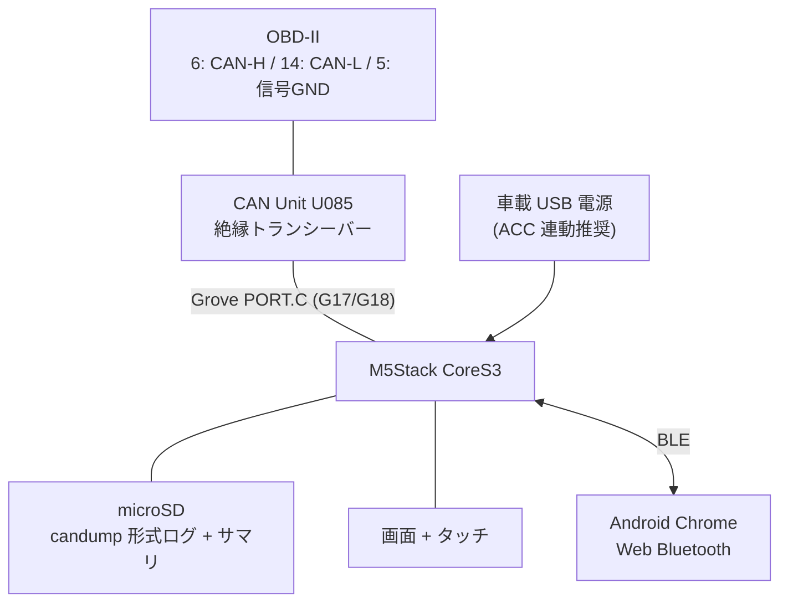
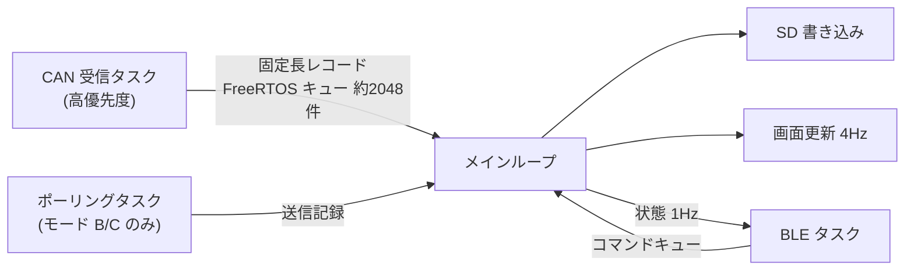

# M5Stack CAN ロガー 構成設計

状態: 設計のみ（未実装）
最終更新: 2026-10-24

## 1. 概要

M5Stack CoreS3 と CAN Unit を OBD-II ポートに接続し、CAN フレームを microSD に記録する。
操作は Android Chrome の Web Bluetooth から行う。本体のタッチ操作だけでも使えるようにする。



OBD-II の 16 番ピン（常時 +12V）は使わない。

## 2. ハードウェア

### 2.1 部品

| 部品 | 型番 | 備考 |
|---|---|---|
| 本体 | M5Stack CoreS3（K128） | ESP32-S3、microSD スロットあり |
| CAN トランシーバー | M5Stack CAN Unit（U085） | CA-IS3050G 絶縁型、最大 1Mbps、HY2.0-4P |
| OBD 接続 | OBD-II オス ピグテール | 6 / 14 / 5 番ピンのみ使用 |
| microSD | 16GB 以下、FAT32 | CoreS3 の対応上限は 16GB |
| 電源 | 車載 USB 充電器（USB-C） | ACC 連動のものを推奨 |

### 2.2 ピン割り当て

CoreS3（公式ドキュメントより）

| 用途 | ピン |
|---|---|
| PORT.A | G2 / G1 |
| PORT.B | G9 / G8 |
| PORT.C（CAN Unit 接続先） | G17 / G18 |
| microSD | MISO G35 / MOSI G37 / SCK G36 / CS G4 |
| LCD | MOSI G37 / SCK G36（microSD と共有） |

Core2 で代用する場合、PORT.C は G13 / G14 となる。ピン定義は `board_config.h` に機種別でまとめる。

### 2.3 配線

| OBD-II | CAN Unit |
|---|---|
| 6（CAN-H） | CAN-H |
| 14（CAN-L） | CAN-L |
| 5（信号 GND） | バス側 GND（端子の有無は要確認） |

## 3. ファームウェア

### 3.1 開発環境

- PlatformIO + Arduino フレームワーク
- M5Unified
- BLE は NimBLE-Arduino を想定
- env: `cores3`（主）、`core2`（代替）、`native`（PC での単体テスト）

### 3.2 ディレクトリ構成

```
CanDash/
├─ platformio.ini
├─ src/
│  ├─ main.cpp             初期化とメインループ
│  ├─ board_config.h       機種別のピン定義
│  ├─ can_capture.*        TWAI の開始/停止、受信タスク、ポーリング
│  ├─ sd_logger.*          candump 形式の書き出し、ローテーション、サマリ
│  ├─ ble_control.*        GATT サーバ
│  ├─ ui.*                 画面表示とタッチボタン
│  └─ candump_format.h     フレーム整形（純粋関数、PC でテスト可能）
├─ test/test_native/       整形処理の単体テスト
├─ web/index.html          Web Bluetooth 操作画面
└─ tools/summarize_candump.py  ID 別の件数・周期・変化バイトの集計
```

### 3.3 タスク構成



- 受信タスク: `twai_receive` で受け取ったフレームを `{時刻µs, ID, flags, DLC, data[8]}` の固定長レコードにしてキューへ入れる。
- メインループ:
  - キューからレコードを取り出し、candump 形式に整形して 8KB のバッファに溜め、SD に書き込む。
  - 1 秒ごとに flush し、64MB でファイルを切り替える。
  - TWAI の状態（エラーカウンタなど）を取得し、画面を更新する。
  - 開始・停止、モード、ビットレートなどの状態変更はすべてここで行う。
- SD と LCD は同じ SPI バスを共有するため、両方ともメインループからのみ操作する。
- BLE とタッチからのコマンドはキュー経由でメインループに渡し、状態変更の競合を防ぐ。

### 3.4 動作モード

| モード | TWAI 設定 | 送信 | 目的 |
|---|---|---|---|
| A: 受信専用（既定） | Listen-only | なし（ACK も返さない） | OBD のブロードキャスト有無の確認 |
| B: PID ポーリング | Normal | `7DF` へ `02 01 xx` を約 10Hz | 標準 PID の応答確認 |
| C: UDS 探索（任意） | Normal | `22xxxx` を許可リストから低頻度で送信 | 独自値の探索 |

ビットレートは 500k（既定）/ 250k / 125k / 1M から選ぶ。

### 3.5 ログ形式

本体ログ: `/canlog/CAN_0001.log`（candump 形式）

```
(1761262800.123456) can0 7E8#064100BE3FA813
```

- 時刻は RTC（BM8563）の時刻と `esp_timer` のマイクロ秒を組み合わせて作る。
- RTC は BLE の `TIME` コマンドでスマホの時刻に合わせる。未設定の場合は起動からの経過時間とする。
- 送信フレームは受信と区別できるよう、インターフェース名を分けて記録する（例: `rx0` / `tx0`）。

サマリ: `/canlog/CAN_0001.txt`（停止時に出力）

- 開始・終了時刻、ビットレート、モード、使用ピン
- 総フレーム数、平均 fps、ユニーク ID 数、ID 別件数
- TWAI 受信エラーカウンタの最大値、バスエラー数、取りこぼし数、キュー溢れ数

### 3.6 本体 UI

- 表示: 状態、モード、ビットレート、ピン、フレーム数、fps、ID 数、エラー、ファイル名、サイズ
- タッチボタン: `[START/STOP]` `[BITRATE]` `[PIN SWAP]`
- PIN SWAP は CAN Unit の TX/RX の線の対応が未確認のため用意する。
- 記録中はビットレートとピンを変更できないようにする。

## 4. BLE / Web Bluetooth

### 4.1 GATT

独自サービスを 1 つ用意する。

| キャラクタリスティック | 属性 | 内容 |
|---|---|---|
| Control | Write | `START` / `STOP` / `MODE A\|B\|C` / `BITRATE <bps>` / `TIME <epoch>` / `SWAP` |
| Status | Notify（1Hz） | JSON `{state, mode, fps, frames, ids, rxErr, busErr, drops, file, size}` |
| Info | Read | ファームウェア版、SD 空き容量、直近 10 件のファイル一覧 |

### 4.2 操作画面

- `web/index.html` を HTTPS で配信する（GitHub Pages を想定）。
- 機能: 接続、開始/停止、モード切替、ビットレート選択、時刻同期、状態表示
- ログファイルは SD を取り外して PC で回収する。BLE でのファイル転送は行わない。
- 大量のファイル回収が必要になった場合は、Wi-Fi AP モードの追加を検討する。

## 5. 安全設計

- 起動時は必ず受信専用（モード A）で始める。
- 送信するのは診断要求（`7DF` / `7E0` 系）のみとする。
- 書き込み系の診断サービス（`2E`、`31`、`34` など）は、ファームウェア側で送信を禁止する。
- 車内配線に分岐接続する場合は、受信専用に固定する。
- OBD 側のバスはすでに終端されているため、CAN Unit に終端抵抗がある場合は外す。
- 操作は停車中に行う。走行中は記録中の表示のみとする。

## 6. 実装ステップ

| ステップ | 内容 | 完了条件 |
|---|---|---|
| 1 | モード A + SD 保存 + タッチ UI + サマリ | 実車で記録し、サマリから結果を判定できる |
| 2 | BLE + Web Bluetooth ページ + 時刻同期 | Android から開始・停止と状態確認ができる |
| 3 | モード B | 標準 PID の応答をログで確認できる |
| 4 | モード C、Wi-Fi AP（任意） | 必要に応じて決める |

## 7. 未確認事項

### 推定（未確認。確定させる方法）

| 推定 | 確定させる方法 |
|---|---|
| ESP32 の TWAI は Listen-only モードを持ち、Arduino 環境から使える | ステップ 1 のビルドと実機確認 |
| CoreS3 の Grove に 5V を出すには電源出力の有効化が必要 | CAN Unit の電源 LED で確認 |
| Web Bluetooth は HTTPS ページから Android Chrome で動作する | ステップ 2 で確認 |
| 診断用バスは低負荷で、SD 書き込みに余裕がある（最大負荷でも約 160KB/s） | 取りこぼし数とキュー溢れ数で実測 |

### 未確認

- [ ] CAN Unit の Grove の黄・白の線と TX/RX の対応
- [ ] CAN Unit の終端抵抗の有無（無通電で CAN-H と CAN-L の間の抵抗を測る）
- [ ] CAN Unit のバス側 GND 端子の有無と、OBD 5 番ピンとの接続方法
- [ ] CoreS3 SE に microSD スロットがあるか（SE を選ぶ場合のみ）

## 8. 代替案

| 案 | 長所 | 短所 |
|---|---|---|
| OBDLink MX+ + スマホアプリ | 標準 PID の確認だけなら最も早い | 受信専用の生ログは取れない |
| ESP32 単体 + SN65HVD230 | 安い | 配線を自作する必要がある |
| CANable などの USB-CAN + PC | 解析ツール（SavvyCAN など）が使える | 車内に PC が必要 |

## 参考

- [M5Stack CoreS3 ドキュメント](https://docs.m5stack.com/en/core/cores3)
- [M5Stack CoreS3 製品ページ（日本語）](https://docs.m5stack.com/ja/products/sku/K128)
- [スイッチサイエンス: CAN-BUS ユニット（CA-IS3050G）](https://www.switch-science.com/catalog/6618/)
- [OpenELAB: M5Stack CANBus Unit](https://openelab.io/products/m5stack-canbus-unit-is3050g)
- [OpenELAB: M5Stack Core2 v1.1](https://openelab.com/products/m5stack-core2-esp32)
